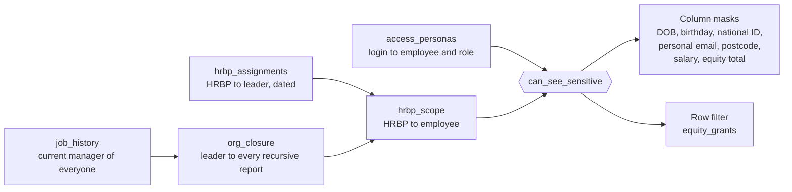

# HRBP access governance at Tema

**The problem.** HR business partners (HRBPs) need sensitive data (birthdays, national IDs, salary, equity) for the organisations they support, and nothing else. "The organisation they support" means everyone who reports, directly or indirectly, to the leaders they're assigned to. That's hard to govern because:

- Coverage follows **leaders**, not departments, so it has to walk the reporting hierarchy.
- **One HRBP can support several leaders**, sometimes in different divisions.
- **One leader can have several HRBPs** (a primary and a secondary for a big org).
- Assignments and reporting lines **change**, and access has to change with them, the same day.

Static grants on tables or departments can't express that. This folder shows a model that can, on Databricks Unity Catalog.

## How Tema is set up

- A **Chief People Officer** reports to the CEO. The People department and an **HR Business Partners** team (about one HRBP per 950 employees, so roughly 70 at full size) report to the CPO.
- **Every VP**, and every **director with 110 or more recursive reports** (mostly in Trust & Safety Operations and Advertiser Support, where teams are large), is assigned an HRBP.
- `hrbp_assignments` records who supports whom: `Primary` or `Secondary`, with `effective_from` and `effective_to` dates. About one leader in nine has two HRBPs, many HRBPs support two to four leaders, and some cover leaders in more than one division. Some past assignments have ended, which you can use to show access ending.

## The model



1. **`org_closure`**: one row for every (leader, person below them) pair at any depth, built with a recursive CTE from the current reporting lines. About 340,000 rows for 70,000 people.
2. **`hrbp_scope`**: for each HRBP, the union of the organisations of the leaders they currently support. Rebuild it with the closure (for example in a daily Lakeflow job) and access follows reorgs and new assignments automatically.
3. **`can_see_sensitive(employee_id)`**: the single rule everything else calls. True for HR admins, for the employee themself, and for an HRBP whose scope contains the employee.
4. **Column masks** on `employee_profile`, so everyone in the table is visible but sensitive columns come back empty outside your scope. **A row filter** on `equity_grants`, so grants outside your scope disappear entirely.
5. **Tags** (`hr_sensitivity = restricted`, `pii`, `compensation`) on every sensitive column, so the policy is visible in Catalog Explorer.

Built-in policy choices, which you can change in one function:

- **Executive carve-out:** VPs and above are never in an HRBP's scope, not even the leader they support. Executive pay usually sits with a separate executive compensation team.
- **Tiered views of the same data:** HRBPs in scope see only the last four characters of a national ID; full IDs are for HR admins and the employee. Direct managers see their reports' birthday (month and day) but not the birth year.
- **Current employees only:** leavers drop out of scope. Many companies give HRBPs a grace period for leavers, which you could add.
- **The People org isn't covered by HRBPs.** HR's own data needs its own rule (often only the CPO's office and HR admins).

## What each persona sees

| Data | HR admin | HRBP, person in scope | HRBP, person out of scope | HRBP, the VP they support | Direct manager | Employee (self) |
|---|---|---|---|---|---|---|
| Name, title, team, location | ✓ | ✓ | ✓ | ✓ | ✓ | ✓ |
| Date of birth | ✓ | ✓ | – | – | – | ✓ |
| Birthday (month and day) | ✓ | ✓ | – | – | ✓ | ✓ |
| National ID | Full | Last 4 | – | – | – | Full |
| Personal email, postcode | ✓ | ✓ | – | – | – | ✓ |
| Base salary | ✓ | ✓ | – | – | – | ✓ |
| Equity granted (4 years) | ✓ | ✓ | – | – | – | ✓ |
| Equity grant rows | All | In scope only | Hidden | Hidden | Hidden | Own only |

## Run it

1. Run `../00_generate_hr_data.py` (it creates `hrbp_assignments` and `equity_grants`, along with the other tables).
2. Run [`01_hrbp_access_model.sql`](01_hrbp_access_model.sql) to build the closure, scope, functions, masks and filters in a `tema_hr_secure` schema.
3. Work through [`02_hrbp_access_activity.sql`](02_hrbp_access_activity.sql). It picks real examples from your data (an HRBP covering more than one division, a leader with two HRBPs, a manager, an employee), lets you **act as** each one, runs the same queries each time, and includes self-checks.

Because you're the only user of a personal workspace, `access_personas` lets you act as any employee and role. Masks and row filters apply to table owners too, so what you see really changes.

## Week 9 files

- [`03_trust_certification_and_access.sql`](03_trust_certification_and_access.sql): metric views granted to `account users` (never the tables), and certified and deprecated tags.
- [`04_adoption_and_access_queries.sql`](04_adoption_and_access_queries.sql): the three datasets for the adoption and access dashboard, from system tables.
- The Week 8 policy changes (leaver grace period, no executive carve-out, secondary HRBPs without national ID) are alternatives, so the finished model keeps the original policy; all three are in [`solutions/week-08-policy-changes.sql`](../../solutions/week-08-policy-changes.sql).

## Taking it to production

| In this demo | In your company |
|---|---|
| `access_personas` table | A login to employee mapping synced from the HR system (work email = login), plus groups such as `hr_admins` and `hrbps` checked with `is_account_group_member()` |
| Column masks set one by one | **ABAC policies** that apply the masks to every column tagged `hr_sensitivity = restricted`, across every table and schema, including new ones |
| `hrbp_assignments` loaded by a script | The HRBP coverage list from your HR system (Workday, SuccessFactors or similar), with effective dates |
| Rebuild by hand | A scheduled job that rebuilds `org_closure` and `hrbp_scope` after each HR system load |
| Trust the demo | Audit with `system.access.audit` and query history: who viewed restricted columns, and when |

A sketch of the ABAC version (check the current syntax in the ABAC docs; governed tags and policies may need account-level permissions that Free Edition doesn't have):

```sql
CREATE POLICY hr_restricted_amounts
ON SCHEMA tema_hr_secure
COLUMN MASK tema_hr_secure.mask_amount
TO `account users` EXCEPT `hr_admins`
FOR TABLES
MATCH COLUMNS has_tag_value('hr_sensitivity', 'restricted') AS col, has_tag('employee_key') AS emp
ON COLUMN col
USING COLUMNS (emp);
```

## Questions to take to your team

1. Who owns the HRBP coverage list today, and how quickly does a change reach access rules?
2. Should HRBPs see the leader they support? Executives? Leavers, and for how long?
3. When a leader has two HRBPs, should both see everything, or should coverage be split (for example by location)?
4. What's the minimum group size for any aggregate an HRBP or manager can see, so nobody can work out one person's pay?
5. Which of these rules already exist in your current HR reporting tool, and could they move into Unity Catalog so that dashboards, Genie and every other tool get them automatically?
